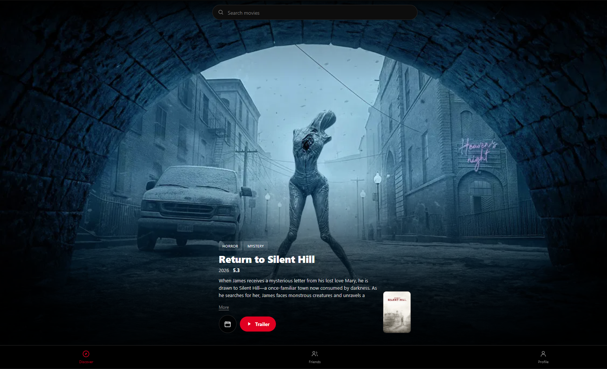

<div align="center">




---

## Why I Built It

I wanted to build a clean, distraction-free way to discover movies through a vertical, full-screen feed where every scroll brings something new. The goal was to combine movie discovery, trailers, personal watch preferences, likes and social features into one simple experience without unnecessary clutter or complicated navigation. I also wanted to build everything using my own stack, with a class-based **PHP REST API**, **MySQL** for accounts, likes and friendships, and a single-file web client built with HTML, CSS and Vanilla JavaScript. The backend is designed to be reusable, making it possible to connect an Android application in the future. The entire application is self-hosted in a **Proxmox LXC container** running Debian, using **Apache, PHP and MySQL**, giving me full control over the application, its data and its infrastructure.

## Features

| Feature | Description |
|---|---|
| Infinite Reels | A full-screen vertical feed of movies, fresh order every time. |
| Live Catalogue | Movies, posters and trailers pulled from the free TMDB API. |
| Trailers | YouTube trailers fetched on demand per movie. |
| Likes | Like a movie to save it and build your taste profile. |
| Friends | Find people and add them; see a friend's taste only from their profile. |
| Search | Search the catalogue by title. |
| Custom Accent | Black-and-white UI with a user-chosen accent colour (presets + custom), saved server-side. |
| Account Settings | A gear on the Profile page to change email and password (each confirms the current password). |
| Admin View | The first registered account is the admin and can see the list of users and their emails. |
| Secure Sessions | Expiring sessions with tokens stored hashed; login rate-limiting; hardening headers. |
| Three Pages | Discover · Friends · Profile. Nothing else. |
| Self-Hosting | Runs on my own Proxmox LXC with Apache, PHP and MySQL. |

---

## Architecture

```text
┌────────────────────────────────────┐
│          Web App (one file)        │
│                                    │
│       HTML · CSS · Vanilla JS      │
│                                    │
│     Discover · Friends · Profile   │
└──────────────────┬─────────────────┘
                   │ fetch() + Bearer token
                   ▼
┌────────────────────────────────────┐
│            PHP REST API            │
│          api/index.php             │
│                                    │
│  auth · feed · trailer · like      │
│  friends · profile · settings      │
└─────────┬────────────────┬─────────┘
          │                │
          ▼                ▼
┌──────────────────┐  ┌──────────────────┐
│      MySQL       │  │    TMDB API      │
│                  │  │                  │
│ users · likes    │  │ discover movies  │
│ friends · colour │  │ videos/trailers  │
└──────────────────┘  └──────────────────┘
          │
          ▼
┌────────────────────────────────────┐
│       Proxmox · Debian LXC         │
│       Apache · PHP · MySQL         │
└────────────────────────────────────┘
```

The backend is organised as small, single-responsibility classes — one class per
file, each with a doc comment describing what it owns:

| Class / File | Responsibility |
|---|---|
| `index.html` | The entire web client (HTML + CSS + JS in one file). |
| `api/index.php` → `Router` | REST API front controller: maps URLs to class methods. |
| `api/lib/Config.php` | Configuration, overridable via environment variables. |
| `api/lib/Http.php` | Reads JSON requests, writes JSON responses. |
| `api/lib/Database.php` | Owns the single shared PDO connection to MySQL. |
| `api/lib/Security.php` | Hardening headers + per-IP login rate limiting. |
| `api/lib/Auth.php` | Register, login, sessions, password changes. |
| `api/lib/Admin.php` | Admin-only user list. |
| `api/lib/MovieApi.php` | TMDB client + offline fallback catalogue. |
| `api/lib/Movies.php` | Feed, search, trailers, likes, taste. |
| `api/lib/Social.php` | Friends and profiles. |
| `api/lib/Settings.php` | Appearance (accent colour). |
| `db/schema.sql` · `db/seed.php` | MySQL schema · admin account. |

---

## Database (MySQL)

Six small tables. Likes drive each user's taste; movies are cached from the API the moment someone likes one.

```sql
CREATE TABLE users (
    id            BIGINT UNSIGNED NOT NULL AUTO_INCREMENT,
    username      VARCHAR(40)  NOT NULL,
    email         VARCHAR(190) NOT NULL,
    password_hash VARCHAR(255) NOT NULL,
    display_name  VARCHAR(80)  NOT NULL DEFAULT '',
    PRIMARY KEY (id),
    UNIQUE KEY uq_username (username)
) ENGINE=InnoDB DEFAULT CHARSET=utf8mb4;

-- The chosen UI accent colour lives per-user.
CREATE TABLE user_settings (
    user_id      BIGINT UNSIGNED NOT NULL,
    accent_color CHAR(7) NOT NULL DEFAULT '#ffffff',
    PRIMARY KEY (user_id),
    FOREIGN KEY (user_id) REFERENCES users(id) ON DELETE CASCADE
) ENGINE=InnoDB;

-- A like = one row; genres are stored on the cached movie so we can
-- summarise "what kind of movies they like".
CREATE TABLE likes (
    user_id    BIGINT UNSIGNED NOT NULL,
    movie_id   BIGINT UNSIGNED NOT NULL,
    created_at TIMESTAMP NOT NULL DEFAULT CURRENT_TIMESTAMP,
    PRIMARY KEY (user_id, movie_id),
    FOREIGN KEY (user_id)  REFERENCES users(id)  ON DELETE CASCADE,
    FOREIGN KEY (movie_id) REFERENCES movies(id) ON DELETE CASCADE
) ENGINE=InnoDB;
```

A friend's **taste** is a single aggregation over the films they've liked:

```sql
SELECT m.genres
FROM likes l
JOIN movies m ON m.id = l.movie_id
WHERE l.user_id = ?;          -- then the top genres are counted in PHP
```

---

## PHP REST API

A single front controller splits `PATH_INFO` into segments and the `Router`
hands each request to the right class method — no framework, and it works
identically under Apache and `php -S`.

```php
// api/index.php
final class Router
{
    public static function dispatch(string $method, array $seg): void
    {
        $r0 = $seg[0] ?? '';
        $id = static fn($i) => (isset($seg[$i]) && ctype_digit($seg[$i])) ? (int) $seg[$i] : null;

        if ($r0 === 'feed'    && $method === 'GET')  Movies::feed();
        if ($r0 === 'search'  && $method === 'GET')  Movies::search();
        if ($r0 === 'like'    && $id(1) && $method === 'POST') Movies::toggleLike($id(1));
        // … auth, me, users, friends …
    }
}
```

### Session authentication

Login creates a session: a random 256-bit token is handed to the client, but only
its **SHA-256 hash** is stored in the `sessions` table (so a leaked database can't be
replayed). Every protected call resolves the token's hash back to a user, and expired
sessions are ignored.

```php
// api/lib/Auth.php
final class Auth
{
    /** The signed-in user, resolved from the session token (null if none/expired). */
    public static function user(): ?array
    {
        $token = self::bearerToken();          // "Authorization: Bearer <token>"
        if (!$token) return null;
        return Database::run(
            "SELECT u.* FROM sessions s
             JOIN users u ON u.id = s.user_id
             WHERE s.token_hash = ? AND s.expires_at > NOW()",
            [hash('sha256', $token)]
        )->fetch() ?: null;
    }

    /** Return the signed-in user, or stop the request with 401. */
    public static function requireUser(): array
    {
        $user = self::user();
        if (!$user) Http::fail('Authentication required.', 401);
        return $user;
    }
}
```

### Changing a password (confirm the old one first)

A password change is refused unless the current password is supplied and verified — the "ask the previous password first" rule.

```php
// api/lib/Auth.php
public static function changePassword(): void
{
    $user = self::requireUser();
    $body = Http::body();

    if (!password_verify($body['current_password'] ?? '', $user['password_hash']))
        Http::fail('Your current password is incorrect.', 403);

    Database::run(
        "UPDATE users SET password_hash = ? WHERE id = ?",
        [password_hash($body['new_password'], PASSWORD_DEFAULT), (int) $user['id']]
    );
    Http::json(['ok' => true]);
}
```

### The infinite feed

`Movies::feed()` asks `MovieApi` for a page and flags the ones you already like. The
client walks pages sequentially from a per-session random offset and de-duplicates by
id, so the feed never repeats while scrolling and starts somewhere new each visit.

```php
// api/lib/Movies.php
public static function feed(): void
{
    $user   = Auth::requireUser();
    $page   = max(1, (int) ($_GET['page'] ?? 1));
    $seed   = max(0, (int) ($_GET['seed'] ?? 0));  // per-session offset for variety
    $movies = MovieApi::feed($page, $seed);
    self::markLiked($movies, (int) $user['id']);   // adds a `liked` flag per movie
    Http::json(['page' => $page, 'movies' => $movies]);
}
```

### Liking a movie (upsert + cache)

When you like a film, its details are cached into `movies` so friends can see it later — a classic `INSERT … ON DUPLICATE KEY UPDATE`.

```php
// api/lib/Movies.php
public static function cacheMovie(array $m): void
{
    Database::run(
        "INSERT INTO movies (id, title, year, overview, poster_url, backdrop_url, genres, rating)
         VALUES (?,?,?,?,?,?,?,?)
         ON DUPLICATE KEY UPDATE
            title = VALUES(title), genres = VALUES(genres), rating = VALUES(rating)",
        [ $m['id'], $m['title'], $m['year'], $m['overview'],
          $m['poster_url'], $m['backdrop_url'], implode(',', $m['genres']), $m['rating'] ]
    );
}
```

### A user's taste (their "best interests")

Taste is a single query over the films someone likes, then the genres are counted in PHP — shown on every profile.

```php
// api/lib/Movies.php
public static function taste(int $userId): array
{
    $rows = Database::run(
        "SELECT m.genres FROM likes l
         JOIN movies m ON m.id = l.movie_id
         WHERE l.user_id = ?", [$userId]
    )->fetchAll();

    $counts = [];
    foreach ($rows as $r)
        foreach (array_filter(explode(',', $r['genres'])) as $g)
            $counts[$g] = ($counts[$g] ?? 0) + 1;

    arsort($counts);
    return array_map(
        fn($name, $count) => ['name' => $name, 'count' => $count],
        array_keys($counts), array_values($counts)
    );
}
```

### The movie API client (with offline fallback)

`MovieApi` wraps the free TMDB API and falls back to a bundled list when no key is set, so the app always runs.

```php
// api/lib/MovieApi.php
public static function feed(int $page = 1): array
{
    if (!self::enabled()) return self::shuffledFallback();   // offline demo mode
    $res = self::get('/discover/movie', [
        'sort_by'        => 'popularity.desc',
        'vote_count.gte' => 150,
        'page'           => random_int(1, 300),              // different every time
    ]);
    if (!$res || empty($res['results'])) return self::shuffledFallback();
    $movies = array_map([self::class, 'shape'], $res['results']);
    shuffle($movies);
    return $movies;
}
```

### API reference

| Method | Route | Purpose |
|---|---|---|
| POST | `/auth/register` · `/auth/login` · `/auth/logout` | accounts (returns a token) |
| GET | `/auth/me` | current user |
| GET | `/feed?page=N` | infinite movie feed |
| GET | `/search?q=` | search movies by title |
| GET | `/trailer/{id}` | YouTube trailer id for a movie |
| POST | `/like/{id}` | like / unlike (toggle) |
| GET | `/me/likes` | movies you like |
| GET / PUT | `/me/settings` | accent colour |
| PUT | `/me/email` | change email (verifies the current password) |
| PUT | `/me/password` | change password (verifies the current one) |
| GET | `/me/friends` · `/me/requests` | friends & pending requests |
| GET | `/users?q=` · `/users/{id}` | find people · a profile + their taste |
| POST | `/friends/{id}` · `/friends/{id}/accept` · DELETE `/friends/{id}` | friend requests |
| GET | `/admin/users` | admin-only: all users + emails |

---

## The Web Client

One `index.html` — HTML, CSS and JavaScript together, so there are no extra asset files that can go missing. It detects the API relative to itself and sends the token on every call:

```js
const API = new URL('api/index.php', location.href).href;

async function api(path, { method = 'GET', body = null } = {}) {
    const opt = { method, headers: {} };
    if (TOKEN) opt.headers['Authorization'] = 'Bearer ' + TOKEN;
    if (body !== null) {
        opt.headers['Content-Type'] = 'application/json';
        opt.body = JSON.stringify(body);
    }
    const res = await fetch(API + path, opt);
    return res.json();
}
```

The accent colour is a single CSS variable, applied instantly and with an auto-contrast text colour:

```js
function setAccent(hex) {
    document.documentElement.style.setProperty('--accent', hex);
    document.documentElement.style.setProperty(
        '--on-accent', luminance(hex) > 0.6 ? '#000' : '#fff');
}
```

Infinite scroll is an `IntersectionObserver` watching a sentinel at the end of the reel list — when it comes into view, the next page is fetched and appended.

---

## Install (Proxmox LXC — Debian/Ubuntu)

### One-shot
```bash
# inside the project folder, as root:
bash install.sh
# optional, for the full live catalogue:
TMDB_API_KEY=your_key bash install.sh
```

### Manual
```bash
apt update
apt install -y apache2 php php-mysql libapache2-mod-php default-mysql-server

mysql <<'SQL'
CREATE DATABASE reelmovies CHARACTER SET utf8mb4 COLLATE utf8mb4_unicode_ci;
CREATE USER 'reel'@'localhost'  IDENTIFIED BY 'reelpass';
CREATE USER 'reel'@'127.0.0.1' IDENTIFIED BY 'reelpass';
GRANT ALL PRIVILEGES ON reelmovies.* TO 'reel'@'localhost';
GRANT ALL PRIVILEGES ON reelmovies.* TO 'reel'@'127.0.0.1';
FLUSH PRIVILEGES;
SQL

cp -a . /var/www/reelmovies
mkdir -p /var/www/reelmovies/data
chown -R www-data:www-data /var/www/reelmovies

cd /var/www/reelmovies
mysql reelmovies < db/schema.sql            # NOTE: drops & recreates tables
DB_USER=reel DB_PASS=reelpass php db/seed.php

cp apache-reelmovies.conf /etc/apache2/sites-available/movies.conf
a2ensite movies && a2dissite 000-default && a2enmod env setenvif && systemctl reload apache2
```
Open `http://<container-ip>/` and **register** — the first account becomes the admin.

> **Apache + login tokens:** Apache strips the `Authorization` header by default, which
> makes every logged-in API call return `401`. The bundled vhost fixes this with
> `CGIPassAuth On`; `install.sh` also writes a `.htaccess` fallback
> (`SetEnvIf Authorization "(.*)" HTTP_AUTHORIZATION=$1`). The `php -S` dev server
> doesn't need this.

### The free movie API key
Create a free account at **https://www.themoviedb.org**, then **Settings → API** and copy the **API Key (v3 auth)**. Provide it as an environment variable — `install.sh` writes it into `.htaccess` for you when you pass it:
```bash
TMDB_API_KEY=your_key bash install.sh
# or for the php -S dev server:
TMDB_API_KEY=your_key php -S 0.0.0.0:8000
```
Without a key the app runs in offline demo mode with a small built-in list; with it, you get the full catalogue, fresh every scroll. Attribution: this product uses the TMDB API but is not endorsed or certified by TMDB.

---

## Security

A few deliberate choices, all in `Auth` and `Security`:

- **Sessions, not passwords on the wire.** Login creates a random 256-bit session token. Only its **SHA-256 hash** is stored, so a leaked database can't be replayed. Sessions **expire** (and slide forward on use).

```php
// api/lib/Auth.php — only the hash is persisted
public static function startSession(int $userId): string
{
    $token = bin2hex(random_bytes(32));
    Database::run(
        "INSERT INTO sessions (token_hash, user_id, expires_at)
         VALUES (?, ?, (NOW() + INTERVAL ? DAY))",
        [hash('sha256', $token), $userId, self::SESSION_DAYS]
    );
    return $token;                 // the raw token is only ever given to the client
}
```

- **Login rate limiting** — failed logins are counted per IP; too many in a short window return `429`, which blunts brute-force and basic DoS attempts without affecting normal use.

```php
// api/lib/Security.php
public static function throttleLogin(string $ip): void
{
    $count = (int) Database::run(
        "SELECT COUNT(*) c FROM login_attempts
         WHERE ip = ? AND created_at > (NOW() - INTERVAL ? MINUTE)",
        [$ip, self::WINDOW_MIN]
    )->fetch()['c'];

    if ($count >= self::MAX_FAILURES)
        Http::fail('Too many login attempts. Please wait a few minutes.', 429);
}
```

- **Passwords** are hashed with `password_hash` (bcrypt) and checked with the constant-time `password_verify`. Changing a password requires the current one and ends all other sessions.
- **Hardening headers** (`X-Content-Type-Options`, `X-Frame-Options`, `Referrer-Policy`) on every API response.
- **Admin** is simply the first account that registers (`users.is_admin`); the admin user list is the only elevated action.

## Notes
- There's no HTTPS built in — put it behind a reverse proxy with TLS before exposing it beyond your LAN.
- `db/schema.sql` **drops and recreates** its tables, so running it wipes existing data (intended for a clean install / upgrade).
- Re-running `install.sh` is safe; re-extract the zip **inside the container** (`unzip …`) to avoid folder-name mangling from Windows tools.